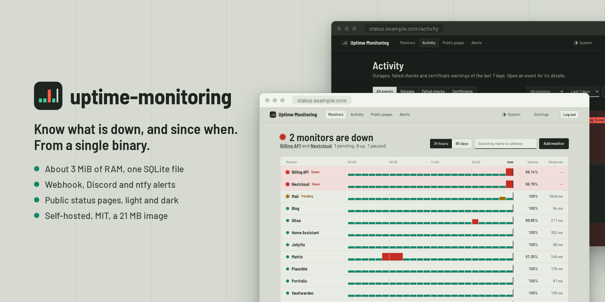

<p align="center">
  
</p>

<h1 align="center">uptime-monitoring</h1>

<p align="center">
  <a href="README.md">English</a> · <a href="README.fr.md">Français</a> · <a href="README.es.md">Español</a> · <strong>Deutsch</strong>
</p>

<p align="center">
  Ein schlanker, selbst gehosteter Uptime-Monitor: eine Binärdatei, eine SQLite-Datei, etwa 3 MiB RAM.
</p>

<p align="center">
  <a href="https://github.com/MathieuMarthy/uptime-monitoring/actions/workflows/ci.yml"></a>
  <a href="https://github.com/MathieuMarthy/uptime-monitoring/pkgs/container/uptime-monitoring"></a>
  <a href="LICENSE"></a>
</p>

<p align="center">
  
</p>

Gebaut, um rund hundert HTTP(S)-Endpunkte von einer im Internet erreichbaren Instanz aus zu überwachen: standardmäßig
sicher und klein genug, um neben den überwachten Websites zu laufen.

## Funktionen

**Prüfungen**
- HTTP(S) mit Methode, Headern, Inhalt, akzeptierten Statuscodes, erwartetem Schlüsselwort, Weiterleitungen und
  Timeouts.
- Push (Heartbeat): Ein Cron-Job, ein Backup oder alles hinter einem NAT ruft nach jedem Lauf eine geheime URL auf;
  offline, wenn die Pings ausbleiben oder der Job selbst einen Fehler meldet.
- Offline nach *N* aufeinanderfolgenden Fehlern, mit schnelleren Prüfungen, während ein Fehler bestätigt wird.
- Ablauf des TLS-Zertifikats bei jeder Prüfung verfolgt.

**Was Sie sehen**
- Ein Dashboard, das in einem Satz sagt, was ausgefallen ist, und dann jeden Monitor auf einer gemeinsamen Zeitachse
  zeigt: Ein Ausfall, der mehrere Websites zur selben Stunde trifft, liegt untereinander.
- Verfügbarkeit aus der tatsächlichen Ausfallzeit berechnet, Balken für 24 Stunden und 90 Tage, stündliche
  Antwortzeiten, Vorfälle.
- Ein Aktivitätsverlauf mit Ausfällen, fehlgeschlagenen Prüfungen und Zertifikatswarnungen, jeweils aufklappbar mit
  den fehlgeschlagenen Prüfungen und den gesendeten Alarmen.
- Öffentliche Statusseiten, jede mit eigener Adresse, eigenen Monitoren und Anzeigenamen; URLs und Fehler werden nie
  angezeigt.
- Helles und dunkles Design, dem System folgend oder in der Kopfzeile gewählt.
- Auf Englisch, Französisch, Spanisch oder Deutsch: Seiten, öffentliche Statusseiten und Alarme.

**Alarme**
- Wenn ein Monitor ausfällt, wieder online ist oder sein Zertifikat bald abläuft.
- Webhook, Discord, ntfy, Telegram und E-Mail (SMTP-Relay), mit Wiederholungen und Zustellprotokoll.

**Sicherheit**
- Ein einziges Administratorkonto: Argon2-Passwort, optionale Zwei-Faktor-Authentifizierung (TOTP),
  `Secure`-Sitzungscookie, CSRF-Schutz, Begrenzung der Anmeldeversuche, strikte CSP.
- Optionales Sperren privater Adressen (localhost, private Netze, Cloud-Metadaten), resistent gegen DNS-Rebinding.
- Ein 21-MB-Distroless-Image, das vor allem anderen die Root-Rechte abgibt.

## Mit Docker starten

```bash
docker run -d --name uptime-monitoring \
  -p 127.0.0.1:8080:8080 \
  -v uptime-data:/data \
  -e PUBLIC_URL=https://status.example.com \
  ghcr.io/mathieumarthy/uptime-monitoring:latest

docker logs uptime-monitoring   # gibt die einmalige Einrichtungs-URL aus
```

Ein Bind-Mount (`-v ./data:/data`) funktioniert ebenfalls, auch wenn Docker das Verzeichnis als root anlegt: Der
Container startet nur als root, um die Datenbankdateien seinem Benutzer (65532 oder `PUID`/`PGID`) zu übergeben, und
gibt die Root-Rechte dann endgültig ab.

Öffnen Sie die Einrichtungs-URL aus den Protokollen, um das Administratorkonto zu erstellen. Bis dahin zeigt die
Instanz nur eine Seite mit Verweis auf die Protokolle, sodass niemand sonst sie übernehmen kann.

### Mit Docker Compose

```yaml
services:
  uptime-monitoring:
    image: ghcr.io/mathieumarthy/uptime-monitoring:latest
    container_name: uptime-monitoring
    restart: unless-stopped
    ports:
      - "127.0.0.1:8080:8080"
    environment:
      PUBLIC_URL: https://status.example.com
      # Hinter einem Reverse-Proxy: Die Anmeldebegrenzung sieht dann die echte Client-IP.
      TRUST_PROXY_HEADERS: "true"
    volumes:
      - ./data:/data
```

```bash
docker compose up -d
docker compose logs uptime-monitoring   # gibt die einmalige Einrichtungs-URL aus
```

Das Sitzungscookie ist `Secure`: Stellen Sie die Instanz hinter einen Reverse-Proxy, der HTTPS ausliefert (Caddy,
Traefik, nginx). Über unverschlüsseltes HTTP funktioniert die Anmeldung nur auf `localhost`.

## Konfiguration

| Variable              | Standard                                 | Zweck |
|-----------------------|------------------------------------------|-------|
| `DATABASE_URL`        | `sqlite://uptime.db` (`/data/uptime.db` im Image) | SQLite-Datei, wird bei Bedarf angelegt |
| `BIND_ADDR`           | `0.0.0.0:8080`                           | Lauschadresse |
| `PUBLIC_URL`          | nicht gesetzt                            | Adresse, unter der Benutzer die Instanz erreichen, z. B. `https://status.example.com`: Alarme verlinken auf die Seite des Monitors |
| `TRUST_PROXY_HEADERS` | `false`                                  | Client-IP aus `X-Forwarded-For` übernehmen; nur hinter einem Proxy aktivieren |
| `RUST_LOG`            | `uptime_monitoring=info,tower_http=info` | Protokollfilter |
| `PUID`, `PGID`        | `65532`                                  | Benutzer und Gruppe des Prozesses, wenn er als root startet; ihnen gehören die Datenbankdateien. Ignoriert, wenn er als anderer Benutzer startet (`user:` in Compose) |

Sprache, Zeitzone, Datenaufbewahrung, das Sperren privater Adressen, das Passwort und die
Zwei-Faktor-Authentifizierung werden auf der Seite *Einstellungen* geändert. Authenticator-App verloren? Schalten Sie
die Zwei-Faktor-Authentifizierung auf dem Server aus und richten Sie sie neu ein:

```bash
docker exec uptime-monitoring /usr/local/bin/uptime-monitoring disable-totp   # Docker
uptime-monitoring disable-totp                                                # aus dem Quellcode, gleiche DATABASE_URL
```

## Aus dem Quellcode bauen

```bash
cargo build --release          # target/release/uptime-monitoring, Ressourcen eingebettet
cargo test
cargo clippy --all-targets -- -D warnings
```

Die Binärdatei ist eigenständig und läuft aus jedem Verzeichnis. TLS-Zertifikate werden gegen den Zertifikatsspeicher
des Systems geprüft.

Entwurfsnotizen (auf Englisch): [`docs/architecture.md`](docs/architecture.md),
[`docs/database-schema.md`](docs/database-schema.md).

## Lizenz

[MIT](LICENSE)
