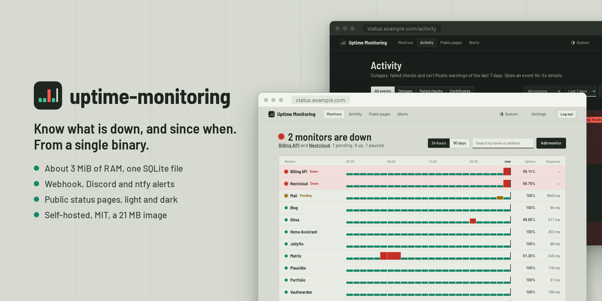

<p align="center">
  
</p>

<h1 align="center">uptime-monitoring</h1>

<p align="center">
  <a href="README.md">English</a> · <a href="README.fr.md">Français</a> · <strong>Español</strong> · <a href="README.de.md">Deutsch</a>
</p>

<p align="center">
  Un monitor de disponibilidad ligero y autoalojado: un binario, un archivo SQLite, unos 3 MiB de RAM.
</p>

<p align="center">
  <a href="https://github.com/MathieuMarthy/uptime-monitoring/actions/workflows/ci.yml"></a>
  <a href="https://github.com/MathieuMarthy/uptime-monitoring/pkgs/container/uptime-monitoring"></a>
  <a href="LICENSE"></a>
</p>

<p align="center">
  
</p>

Pensado para vigilar un centenar de endpoints HTTP(S) desde una instancia expuesta a Internet: seguro por defecto, y
lo bastante pequeño para funcionar junto a los sitios que vigila.

## Funciones

**Comprobaciones**
- HTTP(S) con método, cabeceras, cuerpo, códigos de estado aceptados, palabra clave esperada, redirecciones y tiempos
  de espera.
- Push (heartbeat): una tarea cron, una copia de seguridad o cualquier cosa tras un NAT llama a una URL secreta tras
  cada ejecución; caído cuando los pings se detienen o cuando la propia tarea informa de un fallo.
- Caído tras *N* fallos consecutivos, con comprobaciones más rápidas mientras se confirma un fallo.
- Caducidad del certificado TLS seguida en cada comprobación.

**Lo que ve**
- Un panel que dice en una frase qué está caído y luego muestra cada monitor en un eje de tiempo común: una caída que
  afecta a varios sitios a la misma hora queda alineada.
- Disponibilidad calculada a partir del tiempo de caída real, barras de 24 horas y 90 días, tiempos de respuesta por
  hora, incidentes.
- Un registro de actividad con caídas, comprobaciones fallidas y avisos de certificado, cada uno desplegable con sus
  comprobaciones fallidas y las alertas enviadas.
- Páginas de estado públicas, cada una con su dirección, sus monitores y sus nombres visibles; las URL y los errores
  nunca se muestran.
- Temas claro y oscuro, según el sistema o elegidos en la cabecera.
- En inglés, francés, español o alemán: páginas, páginas de estado públicas y alertas.

**Alertas**
- Cuando un monitor cae, vuelve a estar activo o su certificado está por caducar.
- Webhook, Discord, ntfy, Telegram y correo electrónico (relé SMTP), con reintentos y registro de envíos.

**Seguridad**
- Una sola cuenta de administrador: contraseña Argon2, autenticación en dos pasos (TOTP) opcional, cookie de sesión
  `Secure`, protección CSRF, límite de inicios de sesión, CSP estricta.
- Bloqueo opcional de direcciones privadas (localhost, redes privadas, metadatos en la nube), resistente al DNS
  rebinding.
- Una imagen distroless de 21 MB que abandona root antes de hacer nada.

## Ejecutar con Docker

```bash
docker run -d --name uptime-monitoring \
  -p 127.0.0.1:8080:8080 \
  -v uptime-data:/data \
  -e PUBLIC_URL=https://status.example.com \
  ghcr.io/mathieumarthy/uptime-monitoring:latest

docker logs uptime-monitoring   # muestra la URL de configuración de un solo uso
```

Un montaje de carpeta (`-v ./data:/data`) también funciona, aunque Docker cree la carpeta como root: el contenedor
arranca como root solo para entregar los archivos de la base de datos a su usuario (65532, o `PUID`/`PGID`), y luego
abandona root definitivamente.

Abra la URL de configuración de los registros para crear la cuenta de administrador. Hasta entonces, la instancia
solo muestra una página que remite a los registros, así que nadie más puede apropiársela.

### Con Docker Compose

```yaml
services:
  uptime-monitoring:
    image: ghcr.io/mathieumarthy/uptime-monitoring:latest
    container_name: uptime-monitoring
    restart: unless-stopped
    ports:
      - "127.0.0.1:8080:8080"
    environment:
      PUBLIC_URL: https://status.example.com
      # Tras un proxy inverso: el límite de inicios de sesión ve entonces la IP real del cliente.
      TRUST_PROXY_HEADERS: "true"
    volumes:
      - ./data:/data
```

```bash
docker compose up -d
docker compose logs uptime-monitoring   # muestra la URL de configuración de un solo uso
```

La cookie de sesión es `Secure`: ponga la instancia tras un proxy inverso que sirva HTTPS (Caddy, Traefik, nginx).
Por HTTP simple, el inicio de sesión solo funciona en `localhost`.

## Configuración

| Variable              | Por defecto                              | Uso |
|-----------------------|------------------------------------------|-----|
| `DATABASE_URL`        | `sqlite://uptime.db` (`/data/uptime.db` en la imagen) | Archivo SQLite, creado si no existe |
| `BIND_ADDR`           | `0.0.0.0:8080`                           | Dirección de escucha |
| `PUBLIC_URL`          | sin definir                              | Dirección que usan los usuarios, p. ej. `https://status.example.com`: las alertas enlazan a la página del monitor |
| `TRUST_PROXY_HEADERS` | `false`                                  | Tomar la IP del cliente de `X-Forwarded-For`; actívelo solo tras un proxy |
| `RUST_LOG`            | `uptime_monitoring=info,tower_http=info` | Filtro de registros |
| `PUID`, `PGID`        | `65532`                                  | Usuario y grupo del proceso cuando arranca como root; son dueños de los archivos de la base de datos. Se ignoran si arranca como otro usuario (`user:` en Compose) |

El idioma, la zona horaria, la retención de datos, el bloqueo de direcciones privadas, la contraseña y la
autenticación en dos pasos se cambian desde la página *Ajustes*. ¿Ha perdido su aplicación de autenticación?
Desactive los dos pasos en el servidor y vuelva a configurarlos:

```bash
docker exec uptime-monitoring /usr/local/bin/uptime-monitoring disable-totp   # Docker
uptime-monitoring disable-totp                                                # desde el código, mismo DATABASE_URL
```

## Compilar desde el código

```bash
cargo build --release          # target/release/uptime-monitoring, recursos incluidos
cargo test
cargo clippy --all-targets -- -D warnings
```

El binario es autónomo y se ejecuta desde cualquier carpeta. Los certificados TLS se verifican con el almacén del
sistema.

Notas de diseño (en inglés): [`docs/architecture.md`](docs/architecture.md),
[`docs/database-schema.md`](docs/database-schema.md).

## Licencia

[MIT](LICENSE)
