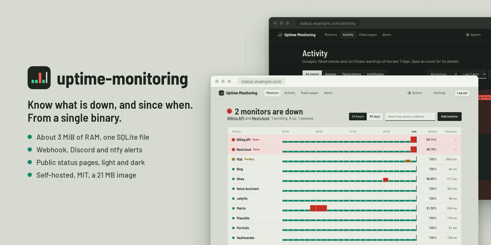

<p align="center">
  
</p>

<h1 align="center">uptime-monitoring</h1>

<p align="center">
  <a href="README.md">English</a> · <strong>Français</strong> · <a href="README.es.md">Español</a> · <a href="README.de.md">Deutsch</a>
</p>

<p align="center">
  Un moniteur de disponibilité léger et auto-hébergé : un binaire, un fichier SQLite, environ 3 Mio de RAM.
</p>

<p align="center">
  <a href="https://github.com/MathieuMarthy/uptime-monitoring/actions/workflows/ci.yml"></a>
  <a href="https://github.com/MathieuMarthy/uptime-monitoring/pkgs/container/uptime-monitoring"></a>
  <a href="LICENSE"></a>
</p>

<p align="center">
  
</p>

Conçu pour surveiller une centaine de points d'accès HTTP(S) depuis une instance exposée sur Internet : sûr par
défaut, et assez petit pour tourner à côté des sites qu'il surveille.

## Fonctionnalités

**Vérifications**
- HTTP(S) avec méthode, en-têtes, corps, codes de statut acceptés, mot-clé attendu, redirections et délais.
- Push (heartbeat) : une tâche cron, une sauvegarde ou tout ce qui est derrière un NAT appelle une URL secrète après
  chaque exécution ; hors ligne quand les pings cessent, ou quand la tâche signale elle-même un échec.
- Hors ligne après *N* échecs consécutifs, avec des revérifications plus rapides pendant la confirmation d'un échec.
- Expiration du certificat TLS suivie à chaque vérification.

**Ce que vous voyez**
- Un tableau de bord qui dit en une phrase ce qui est hors ligne, puis chaque sonde sur un axe de temps commun : une
  panne touchant plusieurs sites à la même heure s'aligne.
- Disponibilité calculée sur l'indisponibilité réelle, barres sur 24 heures et 90 jours, temps de réponse par heure,
  incidents.
- Un fil d'activité des pannes, vérifications échouées et alertes de certificat, chacun se dépliant sur ses
  vérifications échouées et les alertes envoyées.
- Des pages d'état publiques, chacune avec son adresse, ses sondes et ses noms affichés ; les URL et les erreurs n'y
  apparaissent jamais.
- Thèmes clair et sombre, suivant le système ou choisis dans l'en-tête.
- En anglais, français, espagnol ou allemand : pages, pages d'état publiques et alertes.

**Alertes**
- Quand une sonde tombe, revient en ligne, ou que son certificat va expirer.
- Webhook, Discord, ntfy, Telegram et e-mail (relais SMTP), avec nouvelles tentatives et journal d'envois.

**Sécurité**
- Un seul compte administrateur : mot de passe Argon2, authentification à deux facteurs (TOTP) en option, cookie de
  session `Secure`, protection CSRF, limitation des connexions, CSP stricte.
- Blocage facultatif des adresses privées (localhost, réseaux privés, métadonnées cloud), résistant au DNS rebinding.
- Une image distroless de 21 Mo qui abandonne root avant toute chose.

## Lancer avec Docker

```bash
docker run -d --name uptime-monitoring \
  -p 127.0.0.1:8080:8080 \
  -v uptime-data:/data \
  -e PUBLIC_URL=https://status.example.com \
  ghcr.io/mathieumarthy/uptime-monitoring:latest

docker logs uptime-monitoring   # affiche l'URL de configuration à usage unique
```

Un montage de dossier (`-v ./data:/data`) fonctionne aussi, même quand Docker crée le dossier en root : le conteneur
démarre en root seulement pour confier les fichiers de la base à son utilisateur (65532, ou `PUID`/`PGID`), puis
abandonne root définitivement.

Ouvrez l'URL de configuration des journaux pour créer le compte administrateur. D'ici là, l'instance n'affiche
qu'une page renvoyant aux journaux : personne d'autre ne peut se l'approprier.

### Avec Docker Compose

```yaml
services:
  uptime-monitoring:
    image: ghcr.io/mathieumarthy/uptime-monitoring:latest
    container_name: uptime-monitoring
    restart: unless-stopped
    ports:
      - "127.0.0.1:8080:8080"
    environment:
      PUBLIC_URL: https://status.example.com
      # Derrière un proxy inverse : la limitation des connexions voit alors la vraie IP du client.
      TRUST_PROXY_HEADERS: "true"
    volumes:
      - ./data:/data
```

```bash
docker compose up -d
docker compose logs uptime-monitoring   # affiche l'URL de configuration à usage unique
```

Le cookie de session est `Secure` : placez l'instance derrière un proxy inverse qui sert HTTPS (Caddy, Traefik,
nginx). En HTTP simple, la connexion ne fonctionne que sur `localhost`.

## Configuration

| Variable              | Défaut                                   | Rôle |
|-----------------------|------------------------------------------|------|
| `DATABASE_URL`        | `sqlite://uptime.db` (`/data/uptime.db` dans l'image) | Fichier SQLite, créé s'il manque |
| `BIND_ADDR`           | `0.0.0.0:8080`                           | Adresse d'écoute |
| `PUBLIC_URL`          | non définie                              | Adresse utilisée par les utilisateurs, p. ex. `https://status.example.com` : les alertes renvoient vers la page de la sonde |
| `TRUST_PROXY_HEADERS` | `false`                                  | Prendre l'IP du client dans `X-Forwarded-For` ; à activer seulement derrière un proxy |
| `RUST_LOG`            | `uptime_monitoring=info,tower_http=info` | Filtre des journaux |
| `PUID`, `PGID`        | `65532`                                  | Utilisateur et groupe du processus quand il démarre en root ; ils possèdent les fichiers de la base. Ignorés s'il démarre sous un autre utilisateur (`user:` dans Compose) |

La langue, le fuseau horaire, la durée de conservation, le blocage des adresses privées, le mot de passe et
l'authentification à deux facteurs se changent depuis la page *Paramètres*. Application d'authentification perdue ?
Désactivez la double authentification sur le serveur, puis configurez-la de nouveau :

```bash
docker exec uptime-monitoring /usr/local/bin/uptime-monitoring disable-totp   # Docker
uptime-monitoring disable-totp                                                # depuis les sources, même DATABASE_URL
```

## Compiler depuis les sources

```bash
cargo build --release          # target/release/uptime-monitoring, ressources intégrées
cargo test
cargo clippy --all-targets -- -D warnings
```

Le binaire est autonome et se lance depuis n'importe quel dossier. Les certificats TLS sont vérifiés avec le magasin
du système.

Notes de conception (en anglais) : [`docs/architecture.md`](docs/architecture.md),
[`docs/database-schema.md`](docs/database-schema.md).

## Licence

[MIT](LICENSE)
