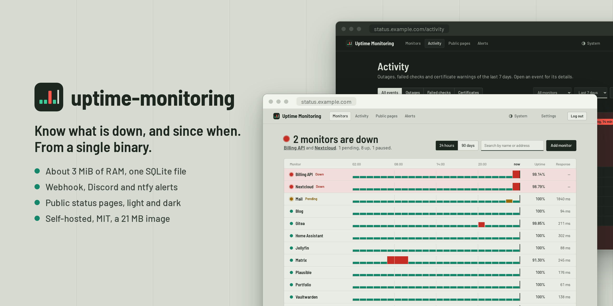

<p align="center">
  
</p>

<h1 align="center">uptime-monitoring</h1>

<p align="center">
  A lightweight, self-hosted uptime monitor: one binary, one SQLite file, about 3 MiB of RAM.
</p>

<p align="center">
  <a href="https://github.com/MathieuMarthy/uptime-monitoring/actions/workflows/ci.yml"></a>
  <a href="https://github.com/MathieuMarthy/uptime-monitoring/pkgs/container/uptime-monitoring"></a>
  <a href="LICENSE"></a>
</p>

<p align="center">
  
</p>

Built to watch about a hundred HTTP(S) endpoints from an instance exposed on the Internet: secure by default, and
small enough to run next to the sites it watches.

## Features

**Checks**
- HTTP(S) with method, headers, body, accepted status codes, expected keyword, redirects and timeouts.
- Push (heartbeat): a cron job, a backup or anything behind a NAT calls a secret URL after each run; down when the
  pings stop, or when the job reports a failure itself.
- Down after *N* consecutive failures, with faster re-checks while a failure is being confirmed.
- TLS certificate expiry tracked on every check.

**What you see**
- A dashboard that says what is down in one sentence, then every monitor on one shared time axis: an outage hitting
  several sites at the same hour lines up.
- Uptime computed from the actual downtime, 24-hour and 90-day bars, hourly response times, incidents.
- An activity feed of outages, failed checks and certificate warnings, each unfolding to its failed checks and the
  alerts sent.
- Public status pages, each with its own address, monitors and display names; URLs and errors are never shown.
- Light and dark themes, following the system or picked in the header.

**Alerts**
- When a monitor goes down, comes back up, or its certificate is about to expire.
- Webhook, Discord and ntfy, retried, with a delivery log.

**Security**
- One admin account: Argon2 password, `Secure` session cookie, CSRF protection, login rate limit, strict CSP.
- Optional blocking of private addresses (localhost, private networks, cloud metadata), resistant to DNS rebinding.
- A 21 MB distroless image that drops root before doing anything.

## Run it with Docker

```bash
docker run -d --name uptime-monitoring \
  -p 127.0.0.1:8080:8080 \
  -v uptime-data:/data \
  -e PUBLIC_URL=https://status.example.com \
  ghcr.io/mathieumarthy/uptime-monitoring:latest

docker logs uptime-monitoring   # prints the one-time setup URL
```

A bind mount (`-v ./data:/data`) works as well, even when Docker creates the directory as root: the container
starts as root only to hand the database files to its user (65532, or `PUID`/`PGID`), then drops root for good.

Open the setup URL from the logs to create the admin account. Until then, the instance only shows a page
pointing to the logs, so nobody else can claim it.

### With Docker Compose

```yaml
services:
  uptime-monitoring:
    image: ghcr.io/mathieumarthy/uptime-monitoring:latest
    container_name: uptime-monitoring
    restart: unless-stopped
    ports:
      - "127.0.0.1:8080:8080"
    environment:
      PUBLIC_URL: https://status.example.com
      # Behind a reverse proxy: the login rate limit then sees the real client IP.
      TRUST_PROXY_HEADERS: "true"
    volumes:
      - ./data:/data
```

```bash
docker compose up -d
docker compose logs uptime-monitoring   # prints the one-time setup URL
```

The session cookie is `Secure`: put the instance behind a reverse proxy that serves HTTPS (Caddy, Traefik,
nginx). Over plain HTTP, logging in only works on `localhost`.

## Configuration

| Variable              | Default                                  | Purpose |
|-----------------------|------------------------------------------|---------|
| `DATABASE_URL`        | `sqlite://uptime.db` (`/data/uptime.db` in the image) | SQLite file, created if missing |
| `BIND_ADDR`           | `0.0.0.0:8080`                           | Listening address |
| `PUBLIC_URL`          | unset                                    | Address users reach, e.g. `https://status.example.com`: alerts link to the monitor's page |
| `TRUST_PROXY_HEADERS` | `false`                                  | Take the client IP from `X-Forwarded-For`; enable only behind a proxy |
| `RUST_LOG`            | `uptime_monitoring=info,tower_http=info` | Log filter |
| `PUID`, `PGID`        | `65532`                                  | User and group the process runs as when started as root; they own the database files. Ignored when started as another user (`user:` in Compose) |

Timezone, data retention, private-address blocking and the password are changed from the *Settings* page.

## Build from source

```bash
cargo build --release          # target/release/uptime-monitoring, assets embedded
cargo test
cargo clippy --all-targets -- -D warnings
```

The binary is self-contained and runs from any directory. TLS certificates are checked against the system
store.

Design notes: [`docs/architecture.md`](docs/architecture.md), [`docs/database-schema.md`](docs/database-schema.md).

## License

[MIT](LICENSE)
