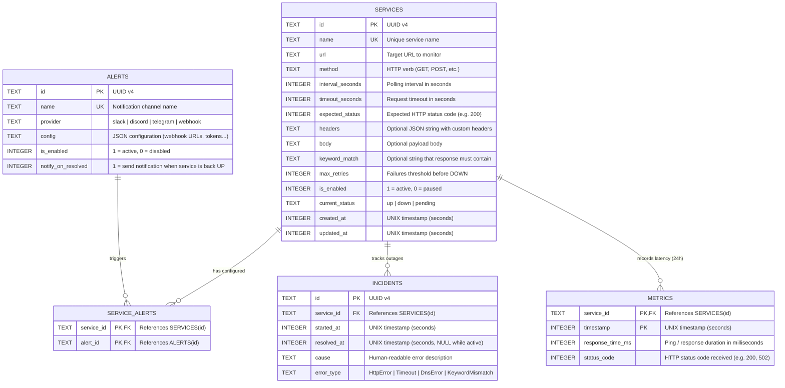

# Database Schema Documentation

This document describes the SQLite database schema, entity relationships, data lifecycle, and conventions used in **uptime-monitoring**.

## Tech Stack & Engine Configuration

- **Database Engine**: [SQLite](https://www.sqlite.org/) (via [SQLx](https://github.com/launchbadge/sqlx))
- **Journal Mode**: `WAL` (Write-Ahead Logging) enabled for high-concurrency non-blocking reads/writes.
- **Foreign Keys**: Enabled (`PRAGMA foreign_keys = ON;`).
- **Synchronous Mode**: `NORMAL` (optimal balance of safety and performance with WAL).
- **Auto-migrations**: Applied on startup using `sqlx::migrate!("./migrations")`.

---

## Entity Relationship Diagram



---

## Tables & Fields Specification

### 1. `services`

Stores the configuration and current operational state of each monitored target.

| Column | SQLite Type | Constraints | Description |
|---|---|---|---|
| `id` | `TEXT` | `PRIMARY KEY` | Unique identifier (UUID v4) |
| `name` | `TEXT` | `NOT NULL UNIQUE` | User-friendly display name |
| `url` | `TEXT` | `NOT NULL` | Full target endpoint URL |
| `method` | `TEXT` | `NOT NULL DEFAULT 'GET'` | HTTP method |
| `interval_seconds` | `INTEGER` | `NOT NULL DEFAULT 60` | Frequency between health checks |
| `timeout_seconds` | `INTEGER` | `NOT NULL DEFAULT 10` | Time before treating request as timed out |
| `expected_status` | `INTEGER` | `NOT NULL DEFAULT 200` | Desired response status code |
| `headers` | `TEXT` | `NULL` | JSON stringified key-value pairs (e.g. Auth tokens) |
| `body` | `TEXT` | `NULL` | Optional request payload |
| `keyword_match` | `TEXT` | `NULL` | Expected substring in response body |
| `max_retries` | `INTEGER` | `NOT NULL DEFAULT 1` | Consecutive failures required before declaring outage |
| `is_enabled` | `INTEGER` | `NOT NULL DEFAULT 1` | `1` if monitoring is active, `0` if paused |
| `current_status` | `TEXT` | `NOT NULL DEFAULT 'up'` | State check: `CHECK(current_status IN ('up', 'down', 'pending'))` |
| `created_at` | `INTEGER` | `NOT NULL` | Creation timestamp (UNIX epoch seconds) |
| `updated_at` | `INTEGER` | `NOT NULL` | Last update timestamp (UNIX epoch seconds) |

---

### 2. `alerts`

Defines external notification channels (Discord, Slack, Webhook, Telegram...).

| Column | SQLite Type | Constraints | Description |
|---|---|---|---|
| `id` | `TEXT` | `PRIMARY KEY` | Unique identifier (UUID v4) |
| `name` | `TEXT` | `NOT NULL UNIQUE` | Channel name (e.g. "#ops-alerts-discord") |
| `provider` | `TEXT` | `NOT NULL` | Destination type (`slack`, `discord`, `webhook`, etc.) |
| `config` | `TEXT` | `NOT NULL` | JSON configuration payload (URLs, secret tokens, headers) |
| `is_enabled` | `INTEGER` | `NOT NULL DEFAULT 1` | Global enable/disable toggle for this alert |
| `notify_on_resolved` | `INTEGER` | `NOT NULL DEFAULT 1` | Whether to send a notification when an incident is resolved |

---

### 3. `service_alerts`

Many-to-Many junction table linking services with their notification channels.

| Column | SQLite Type | Constraints | Description |
|---|---|---|---|
| `service_id` | `TEXT` | `REFERENCES services(id) ON DELETE CASCADE` | Associated service |
| `alert_id` | `TEXT` | `REFERENCES alerts(id) ON DELETE CASCADE` | Associated alert channel |

*Primary Key*: `(service_id, alert_id)`.

---

### 4. `incidents`

Records service outage periods. Rather than keeping millions of logs, downtime is tracked by incident intervals.

| Column | SQLite Type | Constraints | Description |
|---|---|---|---|
| `id` | `TEXT` | `PRIMARY KEY` | Unique identifier (UUID v4) |
| `service_id` | `TEXT` | `NOT NULL REFERENCES services(id) ON DELETE CASCADE` | Target service |
| `started_at` | `INTEGER` | `NOT NULL` | Incident start timestamp (UNIX epoch seconds) |
| `resolved_at` | `INTEGER` | `NULL` | Incident resolution timestamp (`NULL` while still DOWN) |
| `cause` | `TEXT` | `NULL` | Human-readable reason (e.g. `"HTTP 503 Service Unavailable"`) |
| `error_type` | `TEXT` | `NOT NULL` | Error classification (`HttpError`, `Timeout`, `DnsError`...) |

*Indexes*:
- `idx_incidents_service`: `(service_id, started_at DESC)` for fast retrieval of outage history.

#### Incident State Lifecycle:
1. When a service fails `max_retries` consecutive checks:
   - `services.current_status` $\rightarrow$ `'down'`
   - `INSERT INTO incidents (id, service_id, started_at, cause, error_type) ...`
   - Trigger alert: **"Service DOWN"** (sent once).
2. When the service recovers:
   - `services.current_status` $\rightarrow$ `'up'`
   - `UPDATE incidents SET resolved_at = unixepoch() WHERE service_id = ? AND resolved_at IS NULL`
   - Trigger alert: **"Service RESOLVED"** with total downtime duration.

---

### 5. `metrics`

Stores granular response times for drawing latency charts over the last 24 hours.

| Column | SQLite Type | Constraints | Description |
|---|---|---|---|
| `service_id` | `TEXT` | `NOT NULL REFERENCES services(id) ON DELETE CASCADE` | Monitored service |
| `timestamp` | `INTEGER` | `NOT NULL` | Check timestamp (UNIX epoch seconds) |
| `response_time_ms` | `INTEGER` | `NOT NULL` | Latency in milliseconds |
| `status_code` | `INTEGER` | `NULL` | HTTP response code received |

*Primary Key*: `(service_id, timestamp)`.  
*Indexes*:
- `idx_metrics_service_time`: `(service_id, timestamp DESC)` for fast chart queries.

#### 24-Hour Rolling Retention:
To prevent unbounded database growth, older metrics are regularly purged:
```sql
DELETE FROM metrics WHERE timestamp < unixepoch() - 86400;
```
For a service polled every 30 seconds, 24 hours equals **2,880 rows** (~100 KB).
