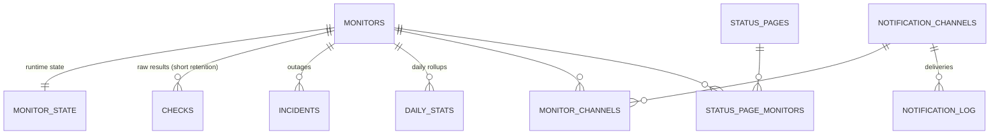

# Database Schema

SQLite schema of **uptime-monitoring**. The source of truth is `migrations/` (the init migration, then later changes).

## Engine configuration

- SQLite via SQLx, migrations embedded and applied at startup.
- `WAL` journal mode, `synchronous = NORMAL`, foreign keys enabled, 5 s busy timeout.

## Conventions

- Timestamps are Unix epoch **milliseconds** (`INTEGER`).
- Ids are `INTEGER PRIMARY KEY`: the `checks` table holds about a million rows, and integer keys keep rows and indexes
  small.
- Booleans are `INTEGER` 0/1.
- Configuration and runtime state live in separate tables (`monitors` / `monitor_state`), so an admin edit and a check
  engine write never touch the same row.

## Entity relationships

`admin`, `sessions` and `settings` stand alone.

## Tables

### `monitors` — configuration, written by the admin

| Column | Type | Constraints / default | Notes |
|---|---|---|---|
| `id` | INTEGER | PK | |
| `name` | TEXT | NOT NULL | |
| `name_key` | TEXT | NOT NULL UNIQUE | Unicode lowercase of `name` in NFC, computed by the application: uniqueness and sort order (`COLLATE NOCASE` only folds ASCII) |
| `group_name` | TEXT | NULL | dashboard group, free text (at most 64 characters); NULL = ungrouped. Compared through its `name_key` form, in the application |
| `kind` | TEXT | NOT NULL DEFAULT `'http'`, CHECK IN (`'http'`, `'push'`) | `push`: the monitored job calls the instance |
| `url` | TEXT | NOT NULL, CHECK empty exactly for `push` | |
| `method` | TEXT | NOT NULL DEFAULT `'GET'`, CHECK IN (GET, HEAD, POST, PUT, PATCH, DELETE) | |
| `headers` | TEXT | NULL | JSON object `{"Name": "value"}` |
| `body` | TEXT | NULL | |
| `keyword` | TEXT | NULL | the response body must contain it |
| `accepted_statuses` | TEXT | NOT NULL DEFAULT `'200-299'` | e.g. `200-299,301` |
| `follow_redirects` | INTEGER | NOT NULL DEFAULT 1 | |
| `ignore_tls_errors` | INTEGER | NOT NULL DEFAULT 0 | accept invalid, self-signed or expired certificates |
| `interval_s` | INTEGER | NOT NULL DEFAULT 60 | |
| `retry_interval_s` | INTEGER | NOT NULL DEFAULT 20 | used while a failure series is below the threshold; ≤ `interval_s` |
| `timeout_s` | INTEGER | NOT NULL DEFAULT 10 | |
| `failure_threshold` | INTEGER | NOT NULL DEFAULT 3, CHECK 1–10 | consecutive failures before Down |
| `tls_expiry_warn_days` | INTEGER | NULL, DEFAULT 14 | NULL = certificate alert disabled |
| `paused` | INTEGER | NOT NULL DEFAULT 0 | |
| `push_token` | TEXT | UNIQUE, CHECK set exactly for `push` | 64 hex characters, the secret of `/push/{token}`; kept readable to be shown again |
| `grace_s` | INTEGER | NOT NULL DEFAULT 0 | push: how late a ping may be after `interval_s`; 0 for HTTP |
| `created_at`, `updated_at` | INTEGER | NOT NULL | |

### `monitor_state` — runtime state, written by the check engine (1:1)

`monitor_id` (PK, FK cascade), `status` (`pending` \| `up` \| `down`, default `pending`), `consecutive_failures`,
`failing_since` (`checked_at` of the first failure of the current series, NULL after a success), `last_check_at`,
`last_latency_ms`, `last_error`, `tls_expires_at`, `tls_warned_for` (expiry date already alerted on), `tls_warned_at`
(when that warning was given; only the last one is kept, for the Activity page).
A row is created in the same transaction as its monitor. Pausing a monitor resets it to `pending` and resolves the
open incident, in the same transaction.

### `checks` — raw results, short retention (default 7 days)

`WITHOUT ROWID`, PK `(monitor_id, checked_at)`: rows are clustered by monitor then time, so the recent history of one
monitor is a contiguous range scan.

`monitor_id`, `checked_at`, `ok` (verdict computed by the engine — the single source of truth), `latency_ms` (NULL
without a response), `status_code`, `error_kind` (`timeout`, `dns`, `blocked`, `connect`, `tls`, `status`, `keyword`; push: `missed`, `reported`), `error`,
`covered_ms` (time since the previous check, 0 when that gap exceeds 2 × (`interval_s` + `grace_s`)), `down` (that time was
downtime: an incident was open when the check was recorded, or opened later from a failure before it).
The first failure of an incident keeps `down = 0` (the time before it was up). Partial index on `checked_at WHERE ok = 0
AND down = 0`: failures that were not downtime, across monitors, for the Activity page, without reading every check.

### `incidents` — outage periods, long retention

`id`, `monitor_id`, `started_at` (first failed check of the series), `resolved_at` (NULL while open; on pause, the last check's time), `error_kind`,
`cause`.
Indexes: `(monitor_id, started_at DESC)`, `started_at` (Activity page); unique partial index on `monitor_id WHERE resolved_at IS NULL` — at most one
open incident per monitor.

### `daily_stats` — daily rollups, long retention

`WITHOUT ROWID`, PK `(monitor_id, day)`. `day` is the local date of the instance timezone, encoded `YYYYMMDD`.
Columns: `monitored_ms`, `downtime_ms`, `checks_total`, `checks_failed`, `latency_avg_ms`, `latency_p95_ms`.

**Uptime** = `1 − downtime / monitored time`, summed from `checks.covered_ms` and `checks.down`. A gap longer than
2 × interval covers nothing, so paused periods and application downtime are excluded from monitored time. Days are
rolled up hourly once complete; `latency_p95_ms` is the nearest-rank percentile.

### Alerts

- `notification_channels`: `id`, `name` (UNIQUE NOCASE), `kind` (`webhook` \| `discord` \| `ntfy`), `config` (JSON,
  validated per kind: `{url}` for webhook and Discord, `{server, topic, token?}` for ntfy), `enabled`, `created_at`.
- `monitor_channels`: `(monitor_id, channel_id)` PK, both FK cascade; index on `channel_id`.
- `notification_log`: `id`, `channel_id`, `monitor_id` (both FK `SET NULL`), `event` (`down` \| `up` \|
  `tls_expiring` \| `test`), `sent_at`, `ok`, `error`. Purged with `checks`. Indexes on `channel_id` and
  `(monitor_id, sent_at)`.

### Public status pages

- `status_pages`: `id`, `slug` (UNIQUE), `title`, `description`, `published`, `created_at`, `updated_at`.
- `status_page_monitors`: `(page_id, monitor_id)` PK, both FK cascade, index on `monitor_id`, `display_name` (NULL = monitor name),
  `position` (display order, from 0). Written as a whole with its page, in one transaction.

### Authentication

- `admin`: single row (`id = 1`), `username`, `password_hash` (Argon2id), `updated_at`.
- `sessions`: `token_hash` (SHA-256 of the session token; the token itself is never stored), `csrf_token`,
  `created_at`, `expires_at`.

### `settings` — single typed row (`id = 1`), created by the migration

| Column | Default |
|---|---|
| `timezone` | `'UTC'` (IANA name; pre-filled from the browser during setup) |
| `checks_retention_days` | 7 (≥ 2) |
| `history_retention_days` | NULL = kept forever (incidents, daily stats); otherwise ≥ `checks_retention_days` |
| `block_private_targets` | 0 |
